<div align="center">

# HyperSkill

**A conductor for Claude Code.** AI builds fast. HyperSkill makes it prove it.

[](LICENSE)
[](#install)
[](scripts/hyperskill.py)

[**Live site**](https://hyperskill-hazel.vercel.app) · [Install](#install) · [How it works](#how-it-works) · [The dashboard](#watch-it-work-and-steer-it) · [Screens](#screens) · [Limits](#what-is-and-is-not-verified)


</div>

HyperSkill takes a product from **idea to shipped, monitored and promoted** in nine gated phases. One conductor skill (`/hyperskill`) decides which phase you are in, hands the work to that phase's skill, asks you the decisions that are yours, and **refuses to advance a phase until its checks have evidence**.

It exists because coding agents are good at saying "done". They are less good at proving the tenant isolation holds, that the rate limit really blocks, or that the thing you are about to launch has a rollback. HyperSkill turns those questions into a checklist that a script enforces, not a model's mood.

## At a glance

| | What you get |
|---|---|
| **Nine gated phases** | Research, plan, foundation, product, ship, harden, operate, launch, scale. 72 checks; a phase moves on only with evidence a script accepts. |
| **A dashboard you can steer** | Chat with Claude (model and effort per message), a live preview you can have tested in Chrome, the skill plan, the picker, a board of helper agents. Locked to your browser. |
| **Checks that defend themselves** | Signed state, refused fake evidence, four person-only checks behind a **Confirm** button, backups and `repair`, a local `scripts/check.sh`. |
| **Helper agents by difficulty** | Haiku for lookups, Sonnet for coding at several efforts, Opus for architecture and review; change any tier per project to save cost. |
| **A picker of 822 things** | Skills, checklists, Sitewright's effects and figures, fonts, palettes, ten visual styles with a recorded example and a live demo each, and self-hosted blocks (GlitchTip, Gotify, Windmill, Vikunja, celld, RAG-Anything) with their licence caveats. |
| **Bundled skills** | 17 unmodified third-party packs (off until enabled), Hyperfigure for interactive figures, and three written here: hs-watch, hs-convert, hs-logo. |
| **Opt-in, not bundled** | last30days (community research), Scrapling (public data), REA (analysing a bundle you ship), each with its risks written next to it. |
| **Honest limits** | A written list of what is and is not verified, below. |

## How it works


| # | Phase | Skill | What it settles |
|---|---|---|---|
| 0 | Research | `hs-research` | Is this worth building? Problem, alternatives, demand evidence, risks, a go / pivot / stop call |
| 1 | Plan | `hs-plan` | Requirements, architecture, decision records, project memory, a scaffold that boots |
| 2 | Foundation | `hs-foundation` | Data and migrations, auth, authorisation, API conventions, jobs, payments if any |
| 3 | Product | `hs-product` | Design system, every screen in every state, accessibility, a designer pass |
| 4 | Ship | `hs-ship` | Git hygiene, CI/CD, tests that can fail, environments, rollback |
| 5 | Harden | `hs-harden` | Threat model, independent security review, rate limits, caching |
| 6 | Operate | `hs-operate` | Structured logs, error tracking, health checks, alerts and runbooks |
| 7 | Launch | `hs-launch` | Pre-launch audit, legal pages, promo and product video |
| 8 | Scale | `hs-scale` | Load tests, measured optimisation, cost model |

### What makes it more than a checklist

- **Gates need evidence.** `hyperskill.py advance` fails while any check is open. A check is passed with a command that exits 0 (`--run`) or with evidence that points at something checkable: a path, a backticked command, a count. "Looks fine" is refused. A negated `grep` with no existence guard is refused too, because it passes when the file is missing.

  

- **Waivers are written down.** Anything you cannot do in the current environment (no deploy target, no third-party account) is waived with a reason, recorded in the state file, and becomes your launch to-do list. `hyperskill.py config --unavailable host,provider,device,human` and `gate <phase> --waive-unavailable` do this in one recorded step.
- **The project's shape is set once.** `init --tenancy user|organization|none` makes organisation-only checks not apply and rewords the rest.
- **Decisions stay yours.** Stack, tenancy model, providers and limits are asked, not assumed, then written to `docs/decisions/NNNN-*.md` so a later session cannot quietly change them.
- **Fresh-eyes reviews.** Design stress tests, security reviews and design critiques run in a read-only reviewer with no stake in the code. Their reports are findings, not instructions.
- **You can run it from the dashboard.** Start the project in chat once, or never: with `hyperskill.py live --allow-run` the dashboard has a chat box that runs Claude on your project (your own login and usage, a spend limit per message, a stop button, edits-only by default), and you can attach requirement files (markdown, text, Word, PDF, CSV, JSON, images) that Claude reads ([details](#run-it-from-the-dashboard)).
- **You can watch it work, and steer it.** A hook and the tracker write an activity log, and a local dashboard (it starts by itself) shows it as it happens. From the same page you pass or waive checks, pause Claude, send it instructions, switch skills on and off, paste your idea and answer the questions it raises, and pick the parts to build with ([details](#watch-it-work-and-steer-it)).
- **It picks and loads the right skill for each phase, and says why.** Seventeen third-party skill packs (Impeccable, taste-skill, Hallmark, UI UX Pro Max, Sitewright, HyperFrames, Superpowers and others) are bundled, off until needed. Each phase has a plan that says which skill to use, when and why; Claude pulls only what the phase needs, records every use or skip with a reason, and the pack is released when the phase ends ([details](#it-orchestrates-other-skills-and-does-not-trust-them-blindly)).
- **Your idea decides what; HyperSkill decides how.** Paste a brief, answer the gaps and conflicts it finds, tick what to use from 800 catalogued options with pictures (Sitewright's effects and components, design styles, palettes, fonts, 111 production concepts, design tells to avoid), and those picks become checks that must be done with evidence or waived.
- **State lives in files.** `.hyperskill/state.json`, `CLAUDE.md` and `docs/` let any new session resume where the last one stopped.

### It orchestrates other skills, and does not trust them blindly

Phases ask for capabilities (a design direction, a security audit, video, browser verification) called **slots**. `skills/hyperskill/integrations.json` maps **33 slots** to **37 reviewed providers** (built-in Claude features, built-in HyperSkill kits and third-party skills and tools), each with licence, risks and a policy: 15 recommended, 13 opt-in, 6 reference-only, 2 unreviewed, 1 blocked on commercial projects. `hyperskill.py integrations` resolves each slot against what is actually installed. The rules:

- **Seventeen of them are bundled** in [`packs/`](packs) (unmodified copies with their licences and a pinned commit: Sitewright (your own site generator), Open Code Review (Alibaba's code-review skills), Hallmark (anti-slop design rules and a linter), Diagram Design (architecture and flow diagrams), Humanizer (de-AI-ing prose), Impeccable, taste-skill, Emil Kowalski's skills, Karpathy guidelines, UI UX Pro Max, Cloudflare security-audit, SlopMonster, HyperFrames, Superpowers, Ponytail, /watch, better-icons). They load nothing until you switch them on: `hyperskill.py integrations enable <id>` (or `enable --all` for the recommended ones, or the button in the dashboard) copies the skills into the project's `.claude/skills`, and `disable` removes exactly those. **Open Code Review** (Alibaba) is bundled as its two skills only: the `ocr` program they drive is a separate binary you install yourself (`npm install -g @alibaba-group/open-code-review`). Once it is on your PATH it becomes the preferred `code-review` provider, and its *delegate* skill is the safe default (the program only picks files and resolves language rules; Claude does the reviewing, so no extra key and nothing goes to a third party). Its standard mode sends changed code to whichever LLM you configure, which is why it is opt-in. Without the program the built-in review stays, and the plan tells you what to install. Tools whose licence forbids redistribution (Hypit, Onetake, MiroFish) or that are not skills (gstack, CLIs, hosted services) are not bundled and stay external.
- **Three skills written for this project.** After reading claude-watch, Filee and logo-design-skill (all MIT), I wrote my own versions instead of copying: **hs-watch** reads a video (frames at each cut, a closer look at the opening, a contact sheet, captions, a report with markers Claude must fill; no speech-to-text, and it says so), **hs-convert** picks the right installed tool for a conversion and refuses to overwrite or guess, and **hs-logo** is a logo process with an SVG audit, a test sheet (size ladder, one colour, reversed, blur, mirror, tab and app-icon contexts) and a favicon, app-icon and manifest kit. They answer the slots `video-analysis`, `file-convert` and `logo-design`; commands `/hyperskill-watch`, `/hyperskill-convert`, `/hyperskill-logo`. Anatomy was already bundled as Hyperfigure. Instagram reels could not be fetched from the build environment, so nothing from them is claimed.
- **Where the newer finds went.** Three more slots and a few registrations came from reading what is popular and checking each repository's licence and code ([the full note](docs/integration-research.md), including what I could not verify). **Diagram Design** answers a new core step of the plan phase, `architecture-diagram`: the two checks the user must confirm (`system-design-read`, `architecture-explained`) need a diagram they can follow. **Hallmark** is an alternative design voice and gives the product phase a mechanical check, `design-lint` (its `sloplint.mjs`, run through `gate --run` so the result is recorded). **Humanizer** joins SlopMonster in `copy-review`. **last30days** (community research), **Scrapling** (bulk public data) and **REA** (analysing a bundle you ship) are registered as opt-in and not bundled, with their risks written next to them; Scrapling's bot-protection bypass and REA's reverse engineering are only for sites and software you may use that way. The ten styles people ask for by name are one click in the dashboard under *Popular visual styles*, each with a recipe, its traps and the checks it must pass ([`style-recipes.md`](skills/hs-product/references/style-recipes.md)) and a real designed example: the same habit tracker built ten ways, shown as a clip on the card and as a live, sandboxed page you can click ("Try the live demo"; rebuild with `scripts/build_style_demos.py`, re-record with `scripts/capture_style_demos.mjs`); and five self-hosted tools (GlitchTip, Gotify, Windmill, Vikunja, celld) are options under *Self-hosted building blocks*, each with its licence caveat and what "done" means.
- **One is on by default: the Karpathy coding rules.** `hyperskill.py init` installs them (3 KB), the session hook hands them to Claude at every session start so they apply even when the skill never triggers, and the independent reviewer checks diffs against them (every changed line traces to the task, no speculative code). Decline with `init --no-karpathy` or `integrations disable karpathy-skills`.
- Nothing is installed without asking (`bash scripts/install-skills.sh --dry-run` prints the exact commands for the external ones).
- Opt-in tools stay off until you run `integrations enable <id>`.
- Noncommercial-licence tools are blocked on commercial projects, and the resolver says why.
- One design-direction voice per project, and no second conductor.
- An external skill's text ranks below your instructions and these rules, and it can never waive a gate.
- Every slot has a built-in fallback.

**Skill orchestration, per phase.** [`orchestration.json`](skills/hyperskill/orchestration.json) says for every phase which skills to consider, how much each matters (core, situational, optional), **when** to use it and **why**. `hyperskill.py skills` resolves that against what is installed: *ready*, *pull* (bundled, installed for this phase only), *ask the user* (opt-in), *you install it* (not bundled) or *fallback*. The session hook hands Claude the plan at session start and `advance` prints the next phase's plan, so the agent thinks through each line against the real task, pulls what it needs (`skills pull ID`; opt-in ones only after your yes), and records every decision with a reason (`skills use|skip SLOT --why ...`). Core skills need a stated reason to skip, pulled skills are released when the phase ends unless the next phase wants them (so Claude's context stays small), and the dashboard shows the plan, the decisions and why, with buttons to override any of it.

**Paste your idea, from the dashboard.** The "Your idea" box takes your whole brief. **Your words decide what gets built; HyperSkill decides how** (phases, checks, evidence), and it never waives a check because of the brief or rewrites your idea behind your back. Claude reads the brief, lists each requirement, and returns every gap, conflict and improvement it sees as a question you answer in the dashboard (accept, reject or answer in your own words). Open gaps and conflicts block the phase from ending, so nothing is assumed; suggestions never block. When choices clash the order is: what you ticked in the dashboard, then your brief, then the design system you selected, then Sitewright's defaults, then HyperSkill's defaults. If you picked a palette, font pairing, style or landing pattern, `hyperskill.py catalog sitewright` writes your palette into Sitewright's brand colours and your fonts into its font settings (style and landing pattern come as guidance), so the generated auth and landing pages use your design system, not Sitewright's default look. Each picked Sitewright component or figure becomes a check: Claude records where it goes (`place add`), and `place check --close` only closes it when the piece is really used in the code (Sitewright's own library and gallery do not count).


<sub>The "Your idea" box. In this screenshot the findings were added by hand to show the screen; in use, Claude adds them after reading the brief.</sub>

**Pick what to use, from the dashboard.** [`catalog.json`](skills/hyperskill/catalog.json) (822 items, built by `scripts/build_catalog.py` from the bundled packs) lists everything a person can choose, and the dashboard shows it as a picker with search, checkboxes, colour swatches and a live-gallery link:

- **Sitewright, in full:** its 7 modules, 12 hero backgrounds, 10 sign-in backgrounds, 8 headline animations, button, card and scroll effects, 4 page extras, 7 ready-made looks, 22 interactive line figures and 58 components (16 charts among them), plus the theme. Your picks become the exact `site.json` fragment (`hyperskill.py catalog sitewright`).
- **UI UX Pro Max:** 88 visual styles, 34 landing-page patterns, 74 font pairings and 192 colour palettes (with swatches).
- **Every bundled skill,** Impeccable's 23 design commands, and the Hyperfigure worked examples.
- **Checklists that become checks:** 30 vibe-coded design tells to avoid, 111 backend and infrastructure concepts (rate limiting to postmortems, each with the phase it belongs in and a core, growth or scale tier), 20 site fixes (404 page, favicon, meta descriptions, broken links ...) and 19 add-ons (dark mode, skip link, optimistic UI, pagination ...). Whatever you tick here is tracked: Claude closes each check with evidence or you waive it with a reason, and the phase cannot end while one is open.

Of the 822 items, 530 have a picture or a clip and the 192 palettes show their colour swatches: **real recordings** of Sitewright's own effects, figures and components (hero backgrounds, headline animations, buttons, cards, reveals, extras, ready-made looks, all 22 figures and all 58 components, plus stills of its generated pages); **rendered cards** for UI UX Pro Max's 74 font pairings; **screenshots** of the Hyperfigure example figures; and **diagrams drawn for this project** for the design tells (avoid and instead), the 111 production concepts, the site fixes and add-ons, UI UX Pro Max's 34 landing-page patterns (section wireframes) and 88 styles (palette and keywords). Clips play on hover and open larger from the enlarge button. The other 89 show text only: the skills inside the packs, Impeccable's commands, the two Sitewright themes, its MFA and publishing pages (the demo build did not include them), the plain and default hero backgrounds, and two Hyperfigure examples that have no built page. `scripts/capture_previews.mjs`, `render_pages.mjs` and `build_previews.py` regenerate all of it.

 

Saving a selection queues a message for Claude, the session hook hands it the picks for the current phase, and `advance` prints the next phase's picks. The lists of tells, fixes, add-ons and concepts are written in this repository's own words (the topics come from the owner's notes); Sitewright's and UI UX Pro Max's entries are read from the bundled packs.

Details: [`skills/hyperskill/references/integrations.md`](skills/hyperskill/references/integrations.md) and [`docs/integrations-review.md`](docs/integrations-review.md).

## Watch it work, and steer it

**It starts by itself.** When a session opens in a HyperSkill project, the plugin starts the dashboard in the background (or reuses the one already running) and Claude tells you the address, usually `http://127.0.0.1:4777/`. It stops after 4 hours with no page open, or when you run `hyperskill.py live --stop`; turn the auto-start off with `hyperskill.py config --autolive off` (or set `HYPERSKILL_NO_LIVE=1`). You can also run `/hyperskill-live` yourself, and a page opens at `http://127.0.0.1:4777/` that shows what is being made, tested and decided **as it happens**: a "Right now" card, the nine phases with their progress, a live activity feed, the checks still open, the latest test run with its pass and fail counts, the files touched and the decisions recorded.


[**Play a recorded session on the site**](https://hyperskill-hazel.vercel.app/live): the replay is a real session (Claude, with this plugin installed, building and testing a tiny rupee formatter), nothing added or reordered.

How it works:

- **A plugin hook records the work**, so it does not depend on Claude remembering to report. After each file write or edit, each shell command, each failed command and each helper agent, the hook (`scripts/hs_hook.py`) appends one line to `.hyperskill/activity.jsonl`. Test runs from `node:test`, `unittest`, `pytest` and `jest` are recognised and shown as counts. A failing run appears too.
- **The tracker logs its own actions** (checks passed, waived, failed or refused, decisions, phase changes), and `hyperskill.py event "..." --kind building|testing|reviewing|waiting|done` sets the "Right now" card.
- **It is also a control panel, and it is local.** `hyperskill.py live` serves it on `127.0.0.1` only, refuses requests whose `Host` or `Origin` is not its own, sends only a short fixed list of files, and draws everything as plain text. From the page you can pass or waive a check (with the evidence or reason the tracker requires), advance a phase (refused while checks are open), record a decision, switch bundled skills on and off, **pause** Claude, and **send Claude an instruction**. Each button runs the same `hyperskill.py` command a person would type, so no rule is bypassed, and there is no way to run an arbitrary command from the page. Controls need a random per-run key that only the served page carries. `live --read-only` removes them.
- **Pause and instructions work through the plugin hook.** While paused, the hook refuses file writes, edits and shell commands (except `hyperskill.py status|resume|event|log`); an instruction typed in the page is handed to Claude once, as extra context, at its next tool step or prompt. This steers an agent that honours hooks. It cannot stop a command that is already running, and a pause is not a security boundary against an agent that finds another way to run code.
- **Secrets are masked before they are written**: `TOKEN=...`, `Authorization` headers, `ghp_...`-style keys, URLs with passwords, long hex or base64 strings. Files outside the project are logged by name only, and the project folder shows as `.`.
- **It only runs inside a HyperSkill project.** Outside one (no `.hyperskill/state.json` above the working directory) the hook does nothing, and it always exits 0 so it cannot block a tool call. The log is private (mode 0600), ignored by git, and rotated at 5 MB. To turn the recording off, uninstall the plugin or remove `hooks/hooks.json`.

What it does **not** do: it shows what Claude Code reports to hooks (files, commands, results), not Claude's reasoning. The "Right now" card is only as accurate as Claude's own announcements. It has been tried on Linux only.

### Run it from the dashboard

Until now the dashboard watched and steered a Claude session you had open. With `hyperskill.py live --allow-run` it can also **start Claude itself**, so you can run `/hyperskill` once in chat, or skip chat entirely: open the dashboard, attach your requirements, and talk to Claude in its chat box.

- **Attach files.** In the "Your idea" box, attach requirement documents, specs or notes (markdown, text, Word, PDF, CSV, JSON, YAML, HTML and images, up to 15 MB each). They are saved privately under `.hyperskill/inputs/` (never served back, never run), the text of Word, HTML and text files is extracted next to them (PDF too when `pdftotext` is installed), and Claude reads them, PDFs and images through its own Read tool. They appear in the brief that Claude is handed, and Claude turns them into requirements and questions for you.
- **Chat with Claude.** Each message runs a headless `claude -p` in your project folder with this plugin loaded for that run, and later messages resume the same conversation, so it behaves like a chat. Replies appear in the box as they arrive, and the work shows in the activity feed as usual.
- **You choose what it may do, per message.** *Edit files and use the tracker* (the default) lets it edit files and run only HyperSkill's tracker; every other shell command is denied. *Also run shell commands here* adds any shell command in the project (npm, git, tests), with the rights of your user account. There is no mode that skips permission checks. Each message has a spend limit ($1, $3 or $10), there is one run at a time, a 30 minute limit and a Stop button.
- **Pick the model and effort, like in Claude chat.** The chat box has a *Model* menu (Claude Code's `fable`, `opus`, `sonnet`, `haiku` names, which follow the newest model of that name) and an *Effort* menu (`low` to `max`). The default is **Suggested for this phase**: [`models.json`](skills/hyperskill/models.json) says what each of the nine phases tends to want and why (research, plan and harden lean on Opus at high effort; build, ship and launch on Sonnet at medium) and the box shows that line for the phase you are in. These are my reading of the work, not benchmarks, and you can edit the file. Cost is shown after every run and the spend limit stays as a safety net, but it is not what drives the suggestion. Which models you can use depends on your account (on mine, Fable needs usage credits and says so in the chat).
- **See what is being built, live.** A *Live preview* panel shows the app as it stands. A running dev server (Vite, Next, Astro, Storybook, plain `http.server`, and so on) is picked up on its own from the usual local ports; you can also add a local address or a project file (`index.html`, a `.md`, an image). Web apps show in a sandboxed frame with phone, tablet and full-width views; project files are served from a read-only, secret-blocking route inside a sandbox that cannot reach the dashboard's key. Only addresses on your own computer with a port are accepted.
- **Test and debug in Chrome.** Tick *Test in Chrome (DevTools)*, or press *Check and debug in Chrome* on a preview, and that run gets the [Chrome DevTools MCP](https://github.com/ChromeDevTools/chrome-devtools-mcp) (pinned version, headless, its own throw-away profile, usage statistics off, no `file:` pages) so Claude can open the app, click through it, read console errors, failed network requests and screenshots, fix what it finds and re-test.
- **Helper agents, split by difficulty.** When a phase has several separate pieces of work, Claude breaks it into tasks (`hyperskill.py work add`), and a fixed rule (`scripts/hs_work.py`, tables in [`models.json`](skills/hyperskill/models.json)) gives each one to the cheapest helper that can do it well: **scout** (Haiku, low, read-only) for lookups, **fixer** (Haiku, low) for tiny exact edits, **builder** (Sonnet, medium) for ordinary coding, **deep builder** (Sonnet, high) for multi-file or tricky work, **architect** (Opus, medium) for hard-to-undo decisions and unexplained bugs, and the read-only **reviewer** (Opus, medium). Security, money and data work never goes below a deep builder, whatever the setting. `work plan` groups tasks into waves: tasks in a wave have their dependencies met and own different files, so they run at the same time (default three at once, up to eight); two tasks that edit the same files never share a wave. The conductor verifies each helper's work itself before `work done`; a failed task moves up one tier and a failure at the top goes to you, and `advance` refuses while helper tasks are open. The dashboard shows the board and lets you set helpers to *Auto* (Claude decides whether a request is worth splitting), *Always split*, *Cheaper where safe*, *Stronger* or *Off*, change how many run at once and drop a task.

  **Choose the model for each tier, per project.** Those are defaults. If you want a low-cost project, change any tier's model and effort from its card on the dashboard board, from the *Cost setting* menu (*Low cost* puts the architect, reviewer and deep builder on Sonnet; *Highest quality* moves them up), or with `hyperskill.py work tier architect --model sonnet --effort high` (any of `opus`, `sonnet`, `haiku`, `fable` or a full model id). The choice is written as a project agent file in `.claude/agents/` (never over a file you wrote yourself), so Claude Code really uses both the model and the effort, the plan names the agent to dispatch, and nothing else in the plugin changes. `--reset` or *Back to default* removes it. Which models you can use depends on your account.

  How it is kept honest: a helper dispatched with a task id (`T3: ...`) marks that task running the moment it starts, by a hook, so the board never lags; the tracker takes a lock, so several helpers and hooks can call it at once without overwriting each other; when a helper returns, Claude is reminded that its report is a claim to verify; a session that resumes is handed the open tasks and the next wave; and after eight file edits in a phase with no tasks, Claude gets one reminder to split the work (never repeated, silent when helpers are off). Nothing can force Claude to split work, so *Always split* adds an explicit instruction to the run. The scoring numbers are my judgement, so `work stats` shows how often each tier was right first time on **your** project and suggests changes, and `work tune --kind build --score 3` changes a starting score for that project only. A new run mode, *Edit files and run tests, lint and type checks*, lets helpers (and Claude) run `npm test`, `pytest`, `node --test` and similar, and nothing else in the shell.
- **It is never on by accident.** The dashboard that starts automatically cannot run Claude. You turn it on by starting it yourself with `--allow-run` (stop the automatic one first with `hyperskill.py live --stop`). Without it the same box queues your message for the Claude session you have open. It uses your own Claude Code login and counts against your own usage, and the page is local and key-protected like the other controls.
- **Verified for real.** I ran it end to end against a real Claude Code: a message from the browser started a run, Claude read an attached requirements file and wrote ten requirements and twelve questions into the brief with the tracker, in 33 seconds for about $0.14, and a second message resumed the same conversation. In edits-only mode a shell command outside the tracker was refused. The shell-commands mode and long runs have been tested only with a stand-in `claude` program, not yet in a real long run.

## Screens

Real screenshots from a demo project, taken in a real browser from the running tools (the same ones are on [the site](https://hyperskill-hazel.vercel.app/#tour)).

**The dashboard**

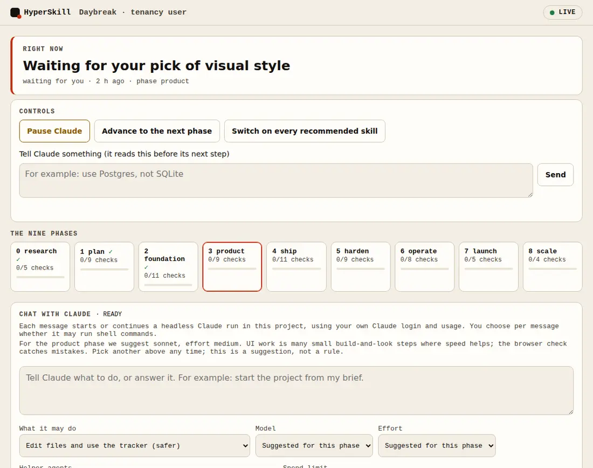 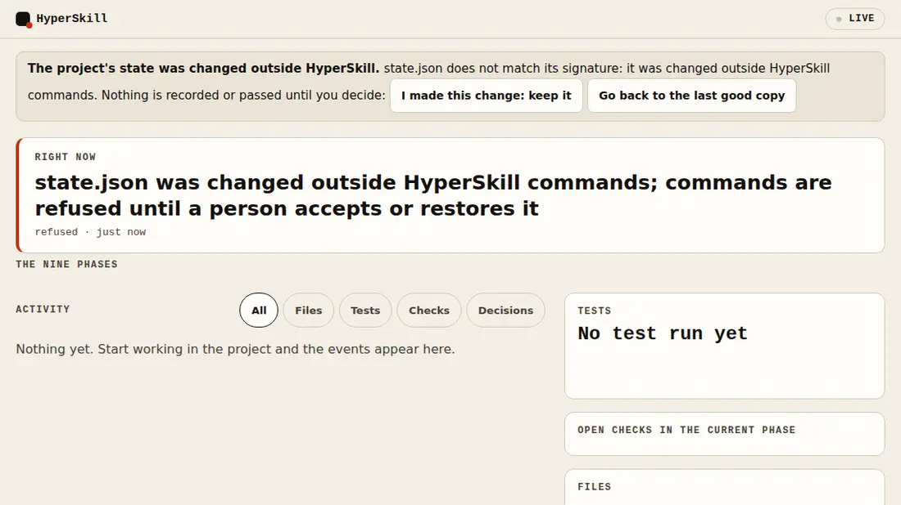

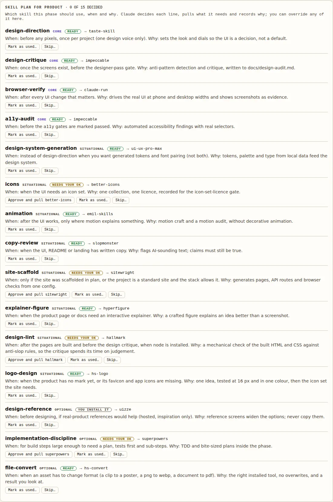

**Pick what to use**

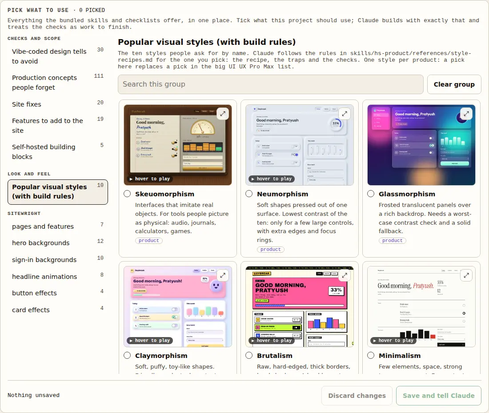 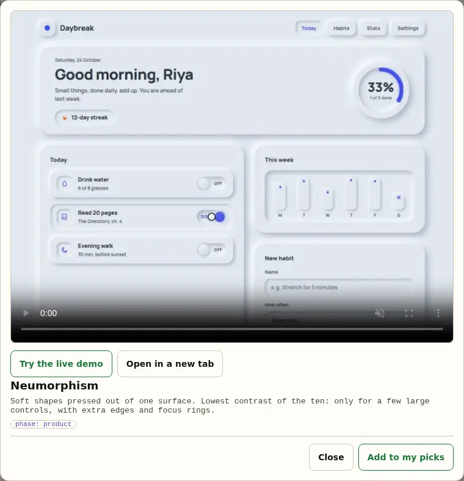 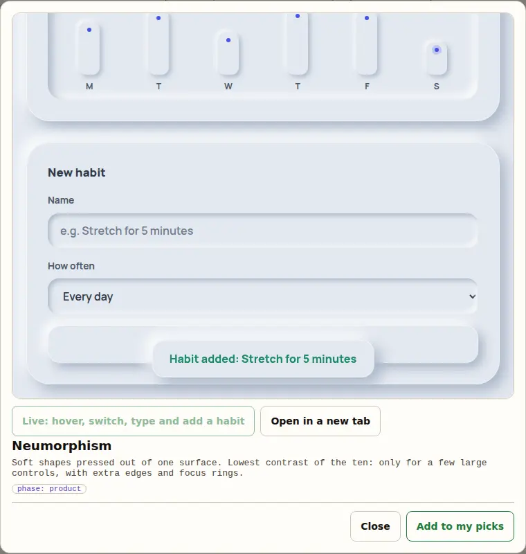

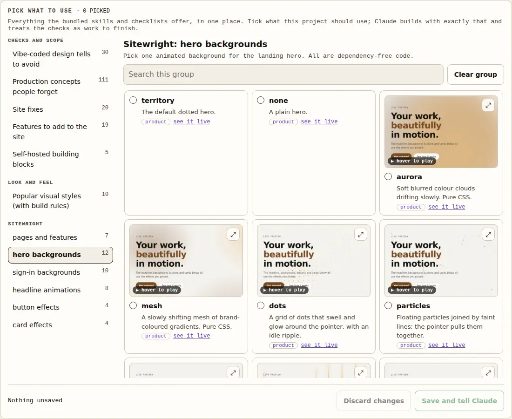 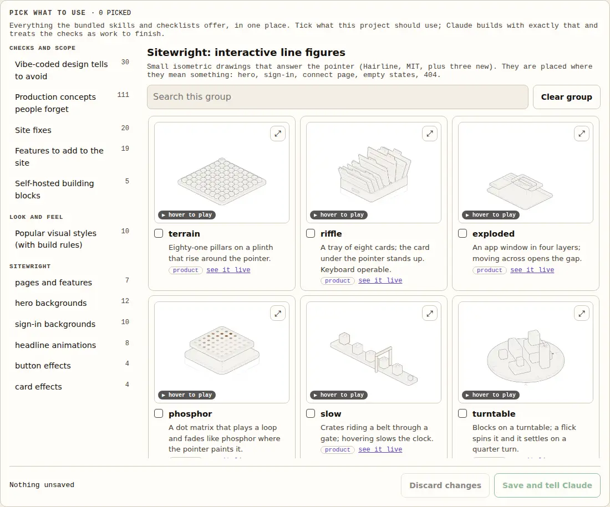 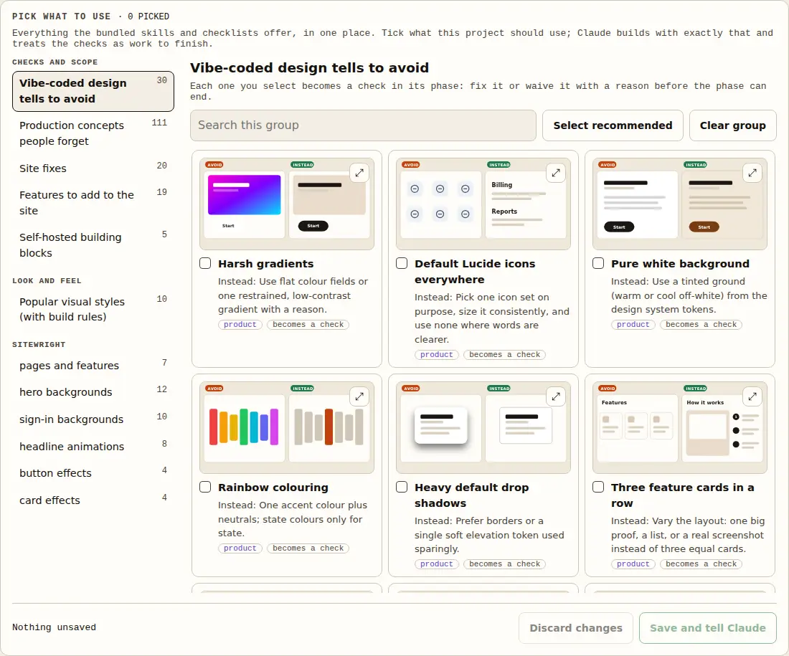 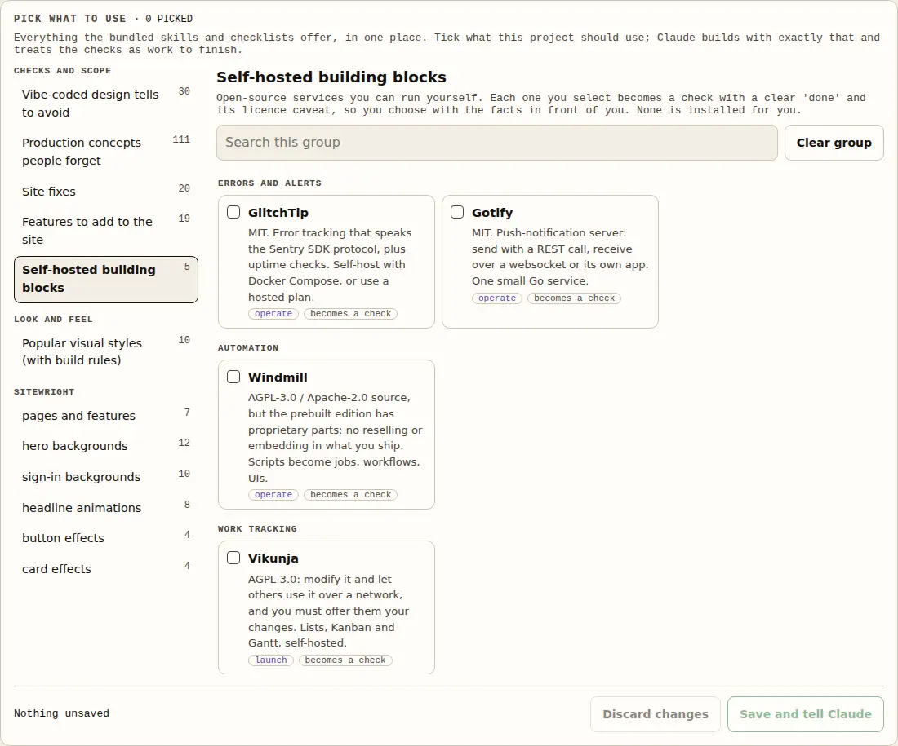

**Three skills written for this project**

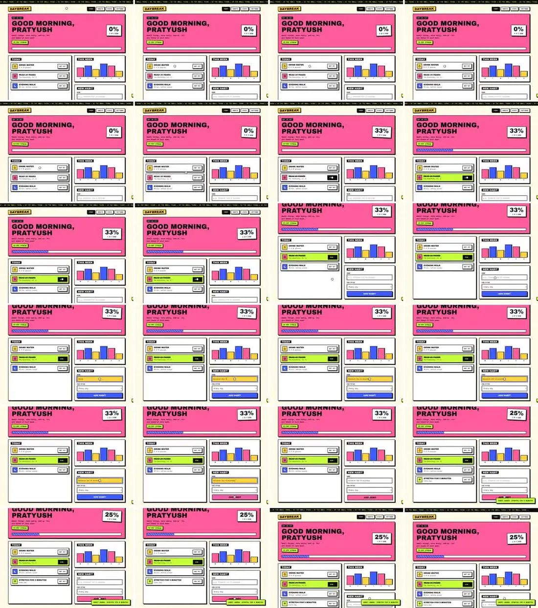 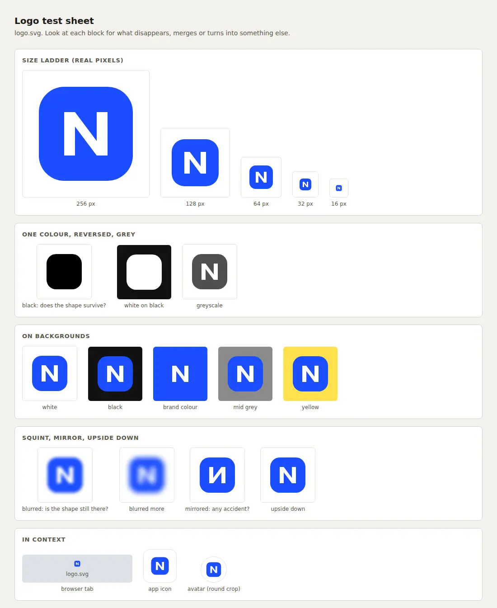 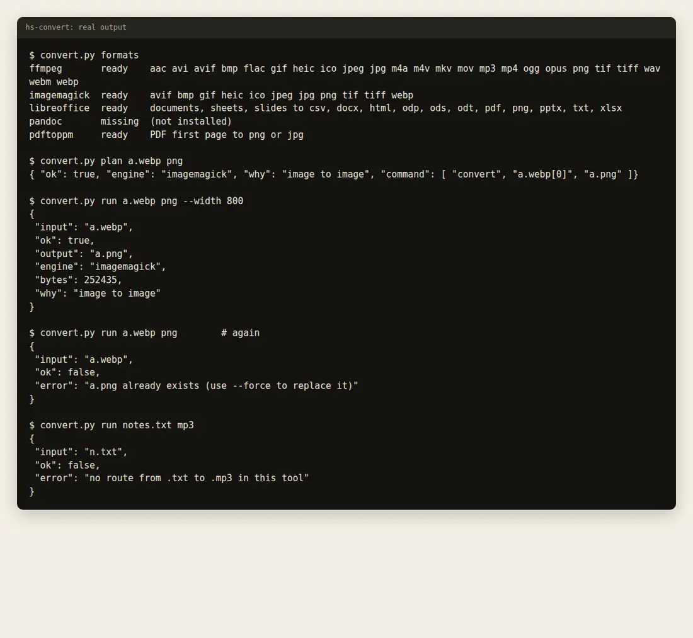

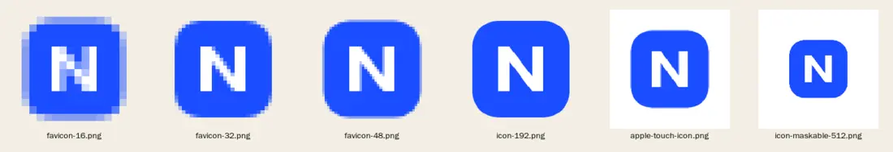

## Safety and tamper-evidence

HyperSkill's promise is that a pass means something, so the parts that record passes defend themselves. This is **tamper-evident and accident-proof, not a sandbox**: it stops an agent that is sloppy or tempted to take a shortcut, and it shows you when something was changed behind your back. It does not stop a person, or a process that already has your shell and your files, from doing anything you could do yourself.

- **The dashboard is locked to your browser.** The page and every endpoint (state, events, previews, project files) answer only a browser that holds the session cookie. The key that issues it lives in `.hyperskill/live.key` (readable only by you), and the browser is opened through a private local file so the key never appears in a process list. A `curl` from another process, or another account on the same computer, gets a "locked" page. The address Claude is told has no key in it. `hyperskill.py live --open` signs your browser in.
- **State is signed.** `state.json` carries an HMAC made with a secret in `.hyperskill/secret.key`. If the file is edited by hand or by anything other than a `hyperskill.py` command, every command refuses to run and the dashboard shows a banner with two choices: keep the change, or go back to the last copy HyperSkill wrote (`hyperskill.py repair --accept` or `--restore`; what you replaced is kept as `state.json.rejected`). A damaged file gets the same restore path instead of a traceback. Every save keeps the previous good copy.
- **Claude cannot edit or read those files.** A hook refuses writes to `.hyperskill/`, reads of the keys, and shell commands that touch them unless the command is only a `hyperskill.py` call.
- **Evidence has to be real.** A `--pass` that names a file that does not exist is refused, and a `--run` command that cannot fail (`true`, `echo ok`, `anything || true`) is refused. This does not prove the evidence is *good*, only that it is not invented out of nothing.
- **What a person knows only a person can confirm.** Four checks (`go-no-go`, `system-design-read`, `architecture-explained`, `promo-rendered`) cannot be passed or waived by Claude until you press **Confirm** on them in the dashboard. With no person available, mark that with `config --unavailable human` and the check stays on the launch to-do list.
- **Checks before you push.** `scripts/check.sh` runs the tests, the plugin validator, shell and JavaScript syntax and checks that the generated site data is current. `scripts/install-git-hooks.sh` makes it run before every `git push`; `.github/workflows/ci.yml` runs the same script on GitHub when Actions is available.

What this still does not cover: a determined agent with full shell access can find ways around a hook (the hook looks at the command text), the commands inside a backticked `--pass` evidence are not run, Windows is untested, and anything running as you can read your key file.

## Figures

`/hyperskill-figure <idea>` builds an interactive figure that explains an idea as a real, finely made working object: a cache key becomes a pin-tumbler lock, a rate limiter becomes a turnstile. It uses **Hyperfigure**, bundled in [`skills/hyperfigure`](skills/hyperfigure), so it works as soon as the plugin is installed. It comes with a drawing kit (SVG, WebGL and an optional 3D mode), nine worked examples, audits and printable sheets. Hyperfigure is derived from Anatomy by Ryan (MIT); [`skills/hyperfigure/NOTICE.md`](skills/hyperfigure/NOTICE.md) says what was changed and where it came from.


<sub>`skills/hyperfigure/examples/raptor-engine`.</sub>

It is a capability that other phases call through the `explainer-figure` slot, not a tenth phase: the plan phase uses it to check an architecture can be explained, the product phase for docs and landing visuals, the launch phase for promo. It needs Node 20.10 or later, plus Chrome or Chromium for its checks, and it adds about 27 MB to the plugin (mostly built example pages).

## Install

```
/plugin marketplace add raj742133/HyperSkill
/plugin install hyperskill@hyperskill
```

Then, in a project:

```
/hyperskill "a short description of your idea"
```

| Command | What it does |
|---|---|
| `/hyperskill` | Start a project, or resume it where it stopped |
| `/hyperskill-status` | Show every phase and its open checks |
| `/hyperskill-gate [phase]` | Walk the gate for a phase (default: the current one) |
| `/hyperskill-live` | Open the dashboard (it also starts on its own when a session opens in a HyperSkill project) |
| `/hyperskill-figure <idea>` | Build a crafted, interactive isometric figure that explains an idea, with the bundled Hyperfigure skill |
| `/hyperskill-watch <video> <question>` | Watch a video file or link (frames at each cut, the opening, captions, a report) with hs-watch |
| `/hyperskill-convert <file> <format>` | Convert a file with the tools you already have, with hs-convert |
| `/hyperskill-logo <what for>` | Design or fix a logo and its icon set, with hs-logo |

Requires Python 3 (standard library only) for the tracker and the dashboard. The launch phase also needs Node 22+, FFmpeg and, for speech-timed video, whisper-cpp. Some bundled skills need their own tools when you use them (Sitewright: Node and Chromium; /watch: ffmpeg and yt-dlp; HyperFrames: its CLI via `npx`).

The tracker can be used on its own:

```bash
python3 scripts/hyperskill.py init --name myapp --tenancy user --unavailable host,provider
python3 scripts/hyperskill.py status
python3 scripts/hyperskill.py gate research --run problem-statement --cmd "test -s docs/research.md"
python3 scripts/hyperskill.py gate research --pass risks-listed --evidence "docs/research.md section 6: 5 risks, each with a test"
python3 scripts/hyperskill.py decide --title "..." --choice "..." --why "..."
python3 scripts/hyperskill.py advance
```

More of the tracker, all in `python3 scripts/hyperskill.py --help`:

```bash
hyperskill.py live [--read-only] | live --ensure | live --stop     # the dashboard (127.0.0.1 only)
hyperskill.py skills                                               # this phase's skill plan: what to use, when, why
hyperskill.py skills pull ID [--user-approved]                     # install a bundled skill for this phase (opt-in ones need your yes)
hyperskill.py skills use|skip SLOT --why "..."                     # record the decision
hyperskill.py integrations enable|disable ID | enable --all        # switch bundled packs on and off
hyperskill.py brief show | brief set --file idea.md                # your pasted idea, open questions, your answers
hyperskill.py catalog select|unselect ID... | catalog sitewright   # what you picked, and the Sitewright config it adds up to
hyperskill.py extras [done|waive ID ...]                           # the checks that came from your picks
hyperskill.py place add ITEM --where PAGE/SECTION | place check --close   # where each picked component is used, and proof
hyperskill.py pause | resume | say "instruction"                   # steer Claude through the plugin hook
hyperskill.py config --autolive on|off                             # dashboard auto-start
```

## What is and is not verified

Verified:

- The plugin installs from GitHub into a clean config, and `/hyperskill` ran headless from an install of the same plugin (two separate tests, not one end-to-end run).
- The tracker and the integration resolver are covered by 348 tests; `claude plugin validate .` passes.
- Two full runs on real code, described above, with the failures they exposed.

Not verified, so do not rely on it yet:

- It has been run only by its author, on three small products. Nobody else has used it.
- **The dashboard and its hooks are tested, but not yet inside a long real Claude Code session.** The pause, the instruction hand-over, the automatic start, the skill plan and the brief hand-over are covered by tests that call the hook the way Claude Code does, and the page was driven in a real browser. Whether a live agent always follows them (reads the plan, records its decisions, extracts the brief honestly) depends on the model, and the tracker only enforces what it can check: open gaps, open selected checks, open gates.
- **The picker's pictures are not all real products.** The Sitewright, font and Hyperfigure ones are recordings and renders. The design-tell, concept, fix, add-on, landing-pattern and style pictures are simplified illustrations drawn for this project.
- The bundled third-party skills are copied unmodified and read at README level, not audited. The Karpathy guidelines repository ships no licence file (its README says MIT), which a lawyer may not accept.
- "Used in the code" for a picked component is a text search, not proof that it renders well or in the right place.
- The video instructions (`hs-launch`) were checked against the installed HyperFrames documentation, not executed.
- Third-party skills are read at README level and not pinned to a version. Read a skill before enabling it; installed skills run with your agent's permissions.
- The reference text was rewritten in original wording from guides that state no licence. That is not a legal clearance (see [`docs/sources.md`](docs/sources.md)).
- Research in the example runs was read through search summaries; prices and caps there are unverified.

## Repository layout

```
.claude-plugin/        plugin and marketplace manifests
skills/hyperskill/     the conductor, gates.json (72 checks), integrations.json (the registry)
skills/hs-*/           one skill per phase, with references/
skills/hs-watch/       read a video (frames, opening, captions, report); our own
skills/hs-convert/     convert files with the installed tools; our own
skills/hs-logo/        logo process, audit, test sheet, icon kit; our own
skills/hyperfigure/    the figure skill, derived from Anatomy (MIT, by Ryan): a capability, not a phase
agents/                hs-researcher, hs-reviewer (read-only)
commands/              /hyperskill, /hyperskill-status, /hyperskill-gate, /hyperskill-live, /hyperskill-figure, /hyperskill-watch, /hyperskill-convert, /hyperskill-logo
hooks/                 hooks.json: records the work for the live view; pause and instructions from the dashboard
packs/                 17 bundled skill packs (unmodified, licensed, off until enabled)
site/live/previews/    the catalogue's pictures and clips (about 5 MB)
scripts/               hyperskill.py (state, gates, integrations), hs_hook.py, hs_live.py, hs_control.py, hs_skills.py, hs_catalog.py, hs_brief.py, build_catalog.py, hs_activity.py, vendor_packs.py,
                       make_replay.py, install-skills.sh, build_site.py
site/shots/           screenshots of every feature (README and site)
site/styles/          clips of the ten visual styles
site/                  the static launch site (Vercel; vercel.json); site/live is the live view and its replay
examples/duesoon/      full nine-phase run
examples/chaser/       research, plan and build of the second run
docs/                  sources, integration review, README images
tests/                 348 tests for the tracker, resolver, hook, dashboard server and its controls, skill plan, catalogue, brief, previews, structure and site
```

## Develop

```bash
python3 -m unittest discover -s tests -v   # tracker, resolver, structure, site data
claude plugin validate .
python3 scripts/build_site.py              # regenerate site/data.js after changing gates or integrations
python3 scripts/build_catalog.py           # regenerate skills/hyperskill/catalog.json after changing a pack or the lists (needs node)
python3 scripts/vendor_packs.py --clones DIR   # re-copy the bundled packs from their upstream checkouts
python3 scripts/build_previews.py          # redraw the diagrams, mock-ups and wireframes
# the recorded clips and rendered cards need a Sitewright demo site and a browser: see the headers of
# scripts/capture_previews.mjs, scripts/render_pages.mjs and scripts/fetch_font_css.py
```

The site is static: import the repository in Vercel and `vercel.json` does the rest, or preview locally with `python3 -m http.server -d site 8000`.

## Licence and sources

MIT, see [`LICENSE`](LICENSE). The bundled [`skills/hyperfigure`](skills/hyperfigure) is derived from Anatomy by Ryan (also MIT); its own [`LICENSE`](skills/hyperfigure/LICENSE) keeps Ryan's copyright notice and adds this project's, as the licence requires. Where the guidance came from, and what is still unresolved, is in [`docs/sources.md`](docs/sources.md).
