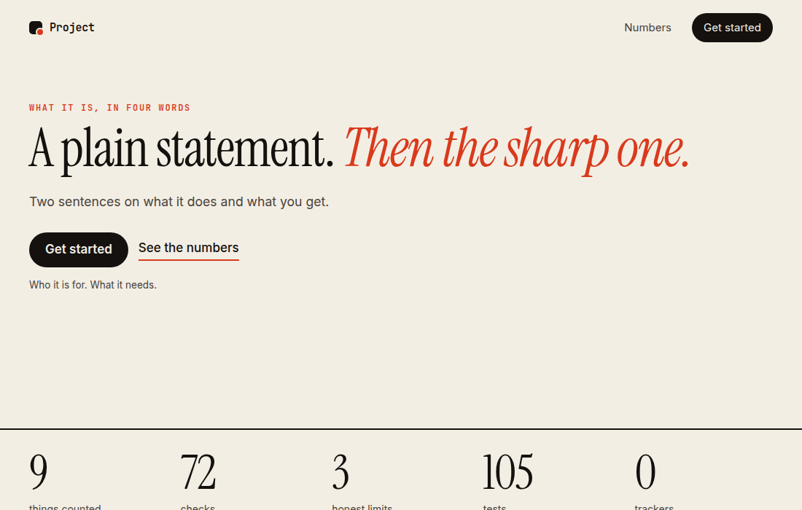
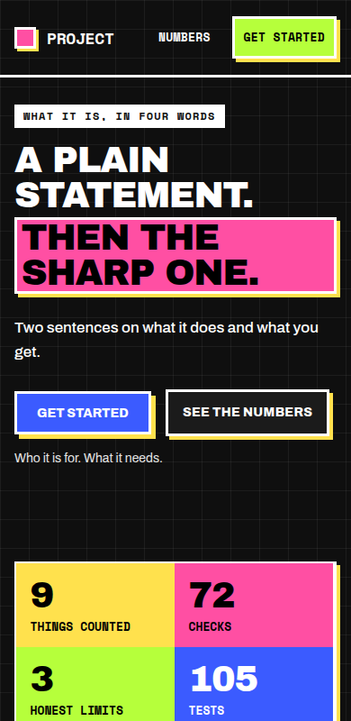

# HyperSkill design system

The look of the HyperSkill site, written down so it can be reused. **Neo-brutalism**: flat saturated fills, one thick black border, one hard offset shadow, heavy capital headlines, a monospace for "the system speaking". It follows this project's own recipe for the style (`skills/hs-product/references/style-recipes.md`).

- Source of truth: [`site/styles.css`](../site/styles.css), [`site/index.html`](../site/index.html), [`site/app.js`](../site/app.js). Live: https://hyperskill-hazel.vercel.app
- Every CSS block below is copied exactly from `site/styles.css` by `scripts/build_design_doc.py`, and a test fails if they drift apart, so you can paste them as they are.
- Plain HTML and CSS, no framework, no build step, no icon library, no images needed for the look.

**Preview.** The starter page from the last section, built from this document's CSS and nothing else: light on a desktop, dark on a phone.

 

## What makes it look like this (the rules)

1. **One border width, one shadow offset.** `--bw` (3px) on every box, `--off` (6px, 4px on phones) for every shadow. Nothing else. This is what makes it deliberate instead of messy.
2. **Hard shadows only.** A solid offset block in `--shadow` (black; yellow in dark mode). No blur, no gradients, no glass, no rounded corners.
3. **Flat fills with a job.** `--yellow` for commands and highlights, `--pink` for the accent, `--lime` for "go" and good states, `--blue` for links and one fill. Text on any fill is always `--on-fill` (black), except white on blue.
4. **Heavy display, calm body.** `--display` (Archivo Black, capitals, tight) for headings and big numbers; `--sans` (Archivo) for reading; `--mono` (Space Mono) for labels, commands, tags and table headers.
5. **Grid paper.** A faint 32px grid on the page background makes the structure visible. It is decoration, so text contrast is measured against the page colour underneath.
6. **A focus ring that is not the border.** `:focus-visible` is a 4px outline in `--focus` (blue; yellow in dark mode), offset by 4px, so it never disappears into a border.
7. **Hover changes colour and shadow, not layout.** Buttons shrink their shadow and take a new fill; nothing moves the page.
8. **Mostly still.** Smooth anchor scroll, hover colour changes, a terminal that types its lines. Everything stops under `prefers-reduced-motion`.

## Quick start

1. Fonts (Archivo Black, Archivo, Space Mono from Google Fonts), in `<head>`:

```html
<link rel="preconnect" href="https://fonts.googleapis.com">
<link rel="preconnect" href="https://fonts.gstatic.com" crossorigin>
<link href="https://fonts.googleapis.com/css2?family=Archivo+Black&family=Archivo:wght@400;500;700;800&family=Space+Mono:wght@400;700&display=swap" rel="stylesheet">
<meta name="theme-color" content="#fff8e1" media="(prefers-color-scheme: light)">
<meta name="theme-color" content="#0f0f0f" media="(prefers-color-scheme: dark)">
```

2. Paste the tokens and the base, then the header and hero.
3. Add the components you need. Each one is independent.

If a page has a strict Content-Security-Policy, the Google Fonts link needs `style-src https://fonts.googleapis.com` and `font-src https://fonts.gstatic.com`; to avoid that, self-host the three families.

## Tokens

| Token | Light | Dark | Use |
|---|---|---|---|
| `--paper` | `#fff8e1` | `#0f0f0f` | Page background |
| `--paper-2` | `#ffffff` | `#1b1b1b` | Panels, cards, table body |
| `--ink` | `#000000` | `#ffffff` | Text |
| `--line` | `#000000` | `#ffffff` | Every border |
| `--shadow` | `#000000` | `#ffe14d` | Every hard shadow |
| `--pink` | `#ff4fa3` | same | The accent; headline block, selected tab |
| `--yellow` | `#ffe14d` | same | Commands, table head, highlights |
| `--blue` | `#3b5bff` | same | Links, one fill, the focus ring (light) |
| `--lime` | `#b6ff3b` | same | Install pill, "recommended", slot tags |
| `--on-fill` | `#000000` | same | Text on any colour fill |
| `--focus` | `#3b5bff` | `#ffe14d` | Focus ring |
| `--bw` | `3px` | same | The one border width |
| `--off` | `6px` (4px on phones) | same | The one shadow offset |

**Contrast** is measured, not eyeballed, with this project's `hs-a11y-review` tools: `page_contrast.py` reads every text element as Chrome paints it, in light and dark, and finds no failures on the site (4.5:1 for text, 3:1 for large text and focus rings). The tightest pair is white on `--blue` at about 5.1:1. Re-run it after any colour change.

## The stylesheet, in blocks

### 1. Tokens and dark theme

The colours, the one border width, the one shadow offset and the three typefaces, plus the dark theme (a system setting or `data-theme`).

```css file=site/styles.css
/* Neo-brutalism, following skills/hs-product/references/style-recipes.md:
   one border width, one shadow offset, flat saturated fills, no blur, no gradients, a focus ring that is not the border. */
:root {
  --paper: #fff8e1;
  --paper-2: #ffffff;
  --ink: #000000;
  --ink-2: #1f1f1f;
  --line: #000000;
  --shadow: #000000;
  --pink: #ff4fa3;
  --yellow: #ffe14d;
  --blue: #3b5bff;
  --lime: #b6ff3b;
  --accent: var(--pink);
  --on-fill: #000000;          /* text on any flat colour fill is always black */
  --focus: #3b5bff;
  --term: #000000;
  --term-ink: #fff8e1;
  --term-dim: #b9b39c;
  --ok: #b6ff3b;
  --bad: #ff8a8a;
  --grid: rgba(0, 0, 0, .07);
  --bw: 3px;                   /* the one border width */
  --off: 6px;                  /* the one shadow offset */
  --display: "Archivo Black", "Arial Black", Impact, system-ui, sans-serif;
  --sans: "Archivo", system-ui, -apple-system, "Segoe UI", Arial, sans-serif;
  --mono: "Space Mono", ui-monospace, "SFMono-Regular", Menlo, monospace;
  --gutter: clamp(16px, 4vw, 40px);
  --max: 1180px;
}
@media (prefers-color-scheme: dark) {
  :root:not([data-theme="light"]) {
    --paper: #0f0f0f; --paper-2: #1b1b1b; --ink: #ffffff; --ink-2: #e6e6e6; --line: #ffffff; --shadow: #ffe14d;
    --grid: rgba(255, 255, 255, .06); --focus: #ffe14d; --term: #000000;
  }
}
:root[data-theme="dark"] {
  --paper: #0f0f0f; --paper-2: #1b1b1b; --ink: #ffffff; --ink-2: #e6e6e6; --line: #ffffff; --shadow: #ffe14d;
  --grid: rgba(255, 255, 255, .06); --focus: #ffe14d; --term: #000000;
}
```

### 2. Base

Reset, the grid-paper page background, links, inline code, the focus ring and the skip link.

```css file=site/styles.css
* { box-sizing: border-box; }
html { scroll-behavior: smooth; }
body {
  margin: 0; background-color: var(--paper); color: var(--ink);
  background-image: linear-gradient(var(--grid) 1px, transparent 1px), linear-gradient(90deg, var(--grid) 1px, transparent 1px);
  background-size: 32px 32px;
  font: 400 17px/1.6 var(--sans); -webkit-font-smoothing: antialiased;
}
a { color: inherit; text-decoration-thickness: 2px; text-decoration-color: var(--blue); text-underline-offset: 3px; }
a:hover { background: var(--yellow); color: var(--on-fill); text-decoration-color: var(--on-fill); }
code, pre { font-family: var(--mono); }
code { font-size: .86em; background: var(--yellow); color: var(--on-fill); padding: .08em .35em; border: 2px solid var(--line); }
:focus-visible { outline: 4px solid var(--focus); outline-offset: 4px; }
.skip { position: absolute; left: -999px; top: 8px; background: var(--yellow); color: var(--on-fill); border: var(--bw) solid var(--line); padding: 8px 14px; z-index: 10; font-weight: 700; }
.skip:focus { left: 8px; }
```

### 3. Header, brand mark and nav

Header, brand square, nav links, the lime install pill, section spacing, the black eyebrow label.

```css file=site/styles.css
.top, main > section, .foot { padding-left: var(--gutter); padding-right: var(--gutter); }
.top { display: flex; align-items: center; justify-content: space-between; flex-wrap: wrap; gap: 12px 20px; max-width: calc(var(--max) + 2 * var(--gutter)); margin: 0 auto; padding-top: 18px; padding-bottom: 18px; border-bottom: var(--bw) solid var(--line); }
.brand { min-height: 44px; font: 700 18px/1 var(--mono); text-transform: uppercase; letter-spacing: -.02em; text-decoration: none; display: inline-flex; align-items: center; gap: 12px; }
.brand:hover { background: none; color: inherit; }
.mark { width: 24px; height: 24px; background: var(--pink); border: var(--bw) solid var(--line); box-shadow: 3px 3px 0 var(--shadow); }
.top nav { display: flex; flex-wrap: wrap; align-items: center; gap: 6px 4px; font: 700 13px/1 var(--mono); text-transform: uppercase; letter-spacing: .02em; }
.top nav a { text-decoration: none; padding: 14px 10px; border: 2px solid transparent; min-height: 44px; display: inline-flex; align-items: center; }
.top nav a:hover { background: var(--yellow); color: var(--on-fill); border-color: var(--line); }
.top nav .pill { min-height: 44px; background: var(--lime); color: var(--on-fill); border: var(--bw) solid var(--line); box-shadow: 4px 4px 0 var(--shadow); margin-left: 8px; }
.top nav .pill:hover { background: var(--pink); }
@media (max-width: 760px) { .top nav a:not(.pill):nth-child(n+4) { display: none; } }

main > section { max-width: calc(var(--max) + 2 * var(--gutter)); margin: 0 auto clamp(56px, 9vw, 112px); }
.eyebrow { display: inline-block; font: 700 12px/1 var(--mono); letter-spacing: .1em; text-transform: uppercase; background: var(--ink); color: var(--paper); padding: 7px 10px; margin: 0 0 16px; }
.fine { font-size: 14px; color: var(--ink-2); margin: 14px 0 0; line-height: 1.5; }
```

### 4. Hero, command box and buttons

The headline with its pink block, the yellow command box and the ghost button.

```css file=site/styles.css
/* hero */
.hero { display: grid; grid-template-columns: minmax(0, 1.05fr) minmax(0, 1fr); gap: clamp(28px, 5vw, 64px); align-items: center; padding-top: clamp(28px, 6vw, 72px); padding-bottom: clamp(40px, 7vw, 90px); }
h1 { font: 400 clamp(40px, 6.2vw, 84px)/.98 var(--display); text-transform: uppercase; letter-spacing: -.03em; margin: 0 0 24px; text-wrap: balance; }
h1 em { font-style: normal; background: var(--pink); color: var(--on-fill); padding: 0 .12em; box-decoration-break: clone; -webkit-box-decoration-break: clone; border: var(--bw) solid var(--line); box-shadow: var(--off) var(--off) 0 var(--shadow); display: inline-block; margin-top: .12em; }
.lede { font-size: clamp(17px, 1.6vw, 20px); font-weight: 500; max-width: 54ch; margin: 0 0 28px; }
.cta { display: flex; flex-wrap: wrap; gap: 16px; align-items: center; }
.cmd { display: flex; align-items: center; background: var(--yellow); color: var(--on-fill); border: var(--bw) solid var(--line); box-shadow: var(--off) var(--off) 0 var(--shadow); padding: 6px 6px 6px 16px; max-width: 100%; min-width: 0; }
.cmd code { background: none; border: 0; color: inherit; font-size: 14px; font-weight: 700; padding: 0; overflow-x: auto; white-space: nowrap; scrollbar-width: none; min-width: 0; }
.cmd code::-webkit-scrollbar { display: none; }
.cmd button { margin-left: 14px; flex: none; border: var(--bw) solid #000; background: #000; color: #fff8e1; font: 700 13px var(--mono); text-transform: uppercase; padding: 10px 14px; min-height: 44px; cursor: pointer; }
.cmd button:hover { background: var(--pink); color: var(--on-fill); }
.ghost { font-weight: 800; text-transform: uppercase; font-size: 14px; letter-spacing: .02em; text-decoration: none; border: var(--bw) solid var(--line); background: var(--paper-2); padding: 12px 16px; box-shadow: 4px 4px 0 var(--shadow); }
.ghost:hover { background: var(--blue); color: #fff; box-shadow: 2px 2px 0 var(--shadow); text-decoration: none; }
```

### 5. Terminal card

A black terminal under a yellow title bar, with a hard pink shadow.

```css file=site/styles.css
/* terminal */
.term { margin: 0; background: var(--term); color: var(--term-ink); border: var(--bw) solid var(--line); box-shadow: 10px 10px 0 var(--pink); min-width: 0; }
.term-bar { display: flex; align-items: center; gap: 12px; padding: 10px 14px; background: var(--yellow); color: var(--on-fill); border-bottom: var(--bw) solid var(--line); font: 700 12px var(--mono); text-transform: uppercase; }
.dots { display: inline-flex; gap: 6px; } .dots i { width: 12px; height: 12px; background: #000; border: 0; }
.dots i:nth-child(2) { background: var(--pink); } .dots i:nth-child(3) { background: var(--blue); }
.term-title { flex: 1; }
.mini { background: #000; border: 2px solid #000; color: #fff8e1; font: 700 12px var(--mono); text-transform: uppercase; padding: 5px 9px; min-height: 44px; cursor: pointer; }
.mini:hover { background: var(--pink); color: var(--on-fill); }
.term-body { margin: 0; padding: 18px 18px 8px; font-size: 12.5px; line-height: 1.55; min-height: 420px; max-height: 520px; overflow: auto; white-space: pre-wrap; word-break: break-word; }
.term-body .p { color: var(--yellow); } .term-body .c { color: var(--term-ink); }
.term-body .ok { color: var(--ok); } .term-body .bad { color: var(--bad); } .term-body .dim { color: var(--term-dim); }
.term figcaption { padding: 4px 18px 16px; font-size: 12px; color: var(--term-dim); }
.term figcaption code { font-size: 12px; background: #222; color: var(--term-ink); border-color: #555; }
```

### 6. Numbers strip

A row of flat-colour cells, each one big number and a label.

```css file=site/styles.css
/* numbers ledger */
.ledger { padding-top: 8px; padding-bottom: 8px; }
.ledger dl { display: grid; grid-template-columns: repeat(auto-fit, minmax(150px, 1fr)); gap: 0; margin: 0; border: var(--bw) solid var(--line); box-shadow: var(--off) var(--off) 0 var(--shadow); background: var(--paper-2); }
.ledger div { min-width: 0; padding: 16px 16px 14px; border-right: var(--bw) solid var(--line); border-bottom: var(--bw) solid var(--line); margin: -1.5px; }
.ledger div:nth-child(4n+1) { background: var(--yellow); color: var(--on-fill); } .ledger div:nth-child(4n+2) { background: var(--pink); color: var(--on-fill); }
.ledger div:nth-child(4n+3) { background: var(--lime); color: var(--on-fill); } .ledger div:nth-child(4n) { background: var(--blue); color: #fff; }
.ledger dt { font: 400 clamp(40px, 5.4vw, 64px)/1 var(--display); letter-spacing: -.03em; }
.ledger dd { margin: 6px 0 0; font: 700 13px/1.3 var(--mono); text-transform: uppercase; }
.ledger .fine { margin-top: 18px; }
```

### 7. Section heads

Display headings in capitals and the sub-heading scale.

```css file=site/styles.css
/* section heads */
.sec-head { max-width: 800px; margin-bottom: 32px; }
h2 { font: 400 clamp(30px, 4.4vw, 54px)/1.02 var(--display); text-transform: uppercase; letter-spacing: -.025em; margin: 0 0 16px; text-wrap: balance; }
.sec-head p { margin: 0; font-weight: 500; }
h3 { font: 800 19px/1.25 var(--sans); margin: 0 0 6px; }
```

### 8. Tabs (a list that becomes a scroller)

A boxed tab list and panel; on a phone the list scrolls sideways inside itself.

```css file=site/styles.css
/* pipeline */
.pipe { display: grid; grid-template-columns: 290px minmax(0, 1fr); border: var(--bw) solid var(--line); box-shadow: var(--off) var(--off) 0 var(--shadow); background: var(--paper-2); }
.phase-list { display: flex; flex-direction: column; border-right: var(--bw) solid var(--line); }
.phase-tab { display: flex; align-items: baseline; gap: 12px; text-align: left; background: var(--paper-2); color: var(--ink); border: 0; border-bottom: 2px solid var(--line); padding: 14px 18px; font: 700 15px/1.3 var(--sans); cursor: pointer; }
.phase-tab:last-child { border-bottom: 0; }
.phase-tab .num { font: 700 12px var(--mono); background: var(--yellow); color: var(--on-fill); border: 2px solid var(--line); padding: 2px 5px; }
.phase-tab:hover { background: var(--yellow); color: var(--on-fill); }
.phase-tab:hover .num { background: #fff; }
.phase-tab[aria-selected="true"] { background: var(--pink); color: var(--on-fill); }
.phase-tab[aria-selected="true"] .num { background: #000; color: #fff8e1; border-color: #000; }
.phase-panel { padding: clamp(20px, 3vw, 36px); background: var(--paper-2); }
.phase-panel h3 { font: 400 clamp(26px, 3.2vw, 40px)/1.02 var(--display); text-transform: uppercase; margin-bottom: 8px; }
.phase-panel .skillname { font: 700 13px var(--mono); margin: 0 0 20px; }
.phase-panel h4 { font: 700 12px var(--mono); letter-spacing: .1em; text-transform: uppercase; background: var(--ink); color: var(--paper); display: inline-block; padding: 5px 8px; margin: 22px 0 12px; }
.gate-items { list-style: none; margin: 0; padding: 0; display: grid; gap: 9px; }
.gate-items li { display: grid; grid-template-columns: 24px 1fr; gap: 10px; font-size: 15px; line-height: 1.5; }
.gate-items li::before { content: ""; width: 16px; height: 16px; margin-top: 4px; border: var(--bw) solid var(--line); background: var(--paper-2); }
.slot-row { display: flex; flex-wrap: wrap; gap: 8px; }
.slot { font: 700 12px var(--mono); border: 2px solid var(--line); padding: 4px 9px; background: var(--lime); color: var(--on-fill); }
@media (max-width: 820px) {
  .pipe { grid-template-columns: minmax(0, 1fr); }
  .phase-list { flex-direction: row; overflow-x: auto; border-right: 0; border-bottom: var(--bw) solid var(--line); scrollbar-width: thin; }
  .phase-tab { border-bottom: 0; border-right: 2px solid var(--line); white-space: nowrap; flex: none; }
}
```

### 9. Numbered rules

Boxed list items with a coloured number tile.

```css file=site/styles.css
/* rules */
.rule-list { list-style: none; counter-reset: r; margin: 0; padding: 0; display: grid; grid-template-columns: repeat(2, minmax(0, 1fr)); gap: 20px; }
.rule-list li { counter-increment: r; border: var(--bw) solid var(--line); background: var(--paper-2); box-shadow: 5px 5px 0 var(--shadow); padding: 18px 18px 22px 74px; position: relative; }
.rule-list li::before { content: "0" counter(r); position: absolute; left: 14px; top: 14px; font: 400 26px/1 var(--display); background: var(--yellow); color: var(--on-fill); border: 2px solid var(--line); padding: 6px 7px; }
.rule-list li:nth-child(4n+2)::before { background: var(--pink); } .rule-list li:nth-child(4n+3)::before { background: var(--lime); } .rule-list li:nth-child(4n)::before { background: var(--blue); color: #fff; }
.rule-list p { margin: 0; font-size: 16px; }
@media (max-width: 720px) { .rule-list { grid-template-columns: minmax(0, 1fr); } }
```

### 10. Chips, table and status tags

Toggle chips, a boxed table and flat status tags.

```css file=site/styles.css
/* bench */
.chips { display: flex; flex-wrap: wrap; gap: 10px; margin-bottom: 20px; }
.chip { font: 700 13px var(--mono); text-transform: uppercase; background: var(--paper-2); color: var(--ink); border: var(--bw) solid var(--line); padding: 8px 12px; min-height: 44px; cursor: pointer; box-shadow: 3px 3px 0 var(--shadow); }
.chip:hover { background: var(--yellow); color: var(--on-fill); }
.chip[aria-pressed="true"] { background: var(--ink); color: var(--paper); box-shadow: none; }
.chip small { font: 700 12px var(--mono); opacity: .8; margin-left: 6px; }
.table-wrap { border: var(--bw) solid var(--line); box-shadow: var(--off) var(--off) 0 var(--shadow); overflow-x: auto; background: var(--paper-2); }
table { width: 100%; border-collapse: collapse; font-size: 14.5px; min-width: 760px; }
th { text-align: left; font: 700 12px var(--mono); letter-spacing: .08em; text-transform: uppercase; background: var(--yellow); color: var(--on-fill); padding: 12px 16px; border-bottom: var(--bw) solid var(--line); }
td { padding: 13px 16px; border-bottom: 2px solid var(--line); vertical-align: top; }
tr:last-child td { border-bottom: 0; }
td.tool b { display: block; font-weight: 800; }
td.tool span { font: 12px var(--mono); }
td.lic { font: 12.5px var(--mono); max-width: 170px; }
td.slots { font: 12px var(--mono); max-width: 200px; }
td.risk { max-width: 300px; }
.tag { display: inline-block; font: 700 12px var(--mono); text-transform: uppercase; padding: 3px 8px; white-space: nowrap; border: 2px solid var(--line); color: var(--on-fill); }
.tag.recommended { background: var(--lime); }
.tag.opt-in { background: var(--yellow); }
.tag.blocked-if-commercial { background: var(--pink); }
.tag.reference-only, .tag.unreviewed { background: #fff; }
```

### 11. Numbered steps

Install steps: a pink number tile and a boxed code block.

```css file=site/styles.css
/* install */
.steps { display: grid; gap: 16px; max-width: 800px; margin-bottom: 18px; }
.step { display: grid; grid-template-columns: 56px 1fr; gap: 16px; align-items: start; }
.step .n { font: 400 28px/1 var(--display); background: var(--pink); color: var(--on-fill); border: var(--bw) solid var(--line); text-align: center; padding: 10px 0; box-shadow: 4px 4px 0 var(--shadow); }
.step pre { margin: 0; background: var(--term); color: var(--term-ink); border: var(--bw) solid var(--line); box-shadow: 5px 5px 0 var(--shadow); padding: 16px 18px; font-size: 13.5px; overflow-x: auto; }
.step code { background: none; border: 0; color: inherit; padding: 0; font-size: inherit; }
```

### 12. Limits list, footer and small-screen rules

The honest-limits list, the footer, reduced motion and the phone adjustments.

```css file=site/styles.css
/* limits */
.limit-list { max-width: 800px; margin: 0; padding: 0 0 0 1.3em; display: grid; gap: 12px; font-weight: 500; }
.limit-list li::marker { color: var(--pink); font-weight: 900; }

.foot { max-width: calc(var(--max) + 2 * var(--gutter)); margin: 0 auto; border-top: var(--bw) solid var(--line); padding-top: 24px; padding-bottom: 48px; display: flex; flex-wrap: wrap; justify-content: space-between; gap: 8px 24px; }
.foot p { margin: 0; font-size: 15px; font-weight: 500; }
.noscript { padding: 16px var(--gutter); background: var(--yellow); color: var(--on-fill); border: var(--bw) solid var(--line); }

@media (max-width: 900px) {
  .hero { grid-template-columns: minmax(0, 1fr); }
  .term-body { min-height: 280px; }
}
@media (prefers-reduced-motion: reduce) { html { scroll-behavior: auto; } * { transition: none !important; animation: none !important; } }

.hero > * { min-width: 0; }

@media (max-width: 520px) {
  :root { --off: 4px; }
  .cmd { flex-wrap: wrap; padding: 12px; gap: 10px; }
  .cmd code { white-space: normal; word-break: break-all; }
  .cmd button { margin-left: 0; }
  .term-title { white-space: nowrap; overflow: hidden; text-overflow: ellipsis; }
  .term { box-shadow: 6px 6px 0 var(--pink); }
}
```

### 13. Feature block with a screenshot

Copy next to a bordered, shadowed screenshot; plus the solid button.

```css file=site/styles.css
/* live view section */
.watch { padding-top: 56px; padding-bottom: 24px; }
.watch-grid { display: grid; grid-template-columns: minmax(0, 1.5fr) minmax(0, 1fr); gap: 36px; align-items: center; margin-top: 8px; }
.watch-shot { margin: 0; }
.watch-shot img { display: block; width: 100%; height: auto; border: var(--bw) solid var(--line); box-shadow: var(--off) var(--off) 0 var(--shadow); background: var(--paper-2); }
.watch-shot figcaption { margin-top: 12px; font-size: 14px; font-weight: 500; }
.tick { list-style: none; margin: 0 0 20px; padding: 0; }
.tick li { padding: 10px 0 10px 32px; border-top: 2px solid var(--line); position: relative; font-weight: 500; }
.tick li:first-child { border-top: 0; }
.tick li::before { content: ""; position: absolute; left: 0; top: 17px; width: 16px; height: 16px; background: var(--lime); border: 2px solid var(--line); }
.solid { display: inline-flex; align-items: center; min-height: 48px; padding: 0 22px; background: var(--blue); color: #fff; border: var(--bw) solid var(--line); box-shadow: 5px 5px 0 var(--shadow); font: 800 14px var(--sans); text-transform: uppercase; text-decoration: none; }
.solid:hover { background: var(--pink); color: var(--on-fill); box-shadow: 2px 2px 0 var(--shadow); text-decoration: none; }
@media (max-width: 860px) { .watch-grid { grid-template-columns: 1fr; } }
```

### 14. Screenshot rows, pack list, style grid, tour and card grid

Rows, lists and grids built from the same border, shadow and flat fills.

```css file=site/styles.css
.dash, .packs, .styles, .tour, .more, .roadmap { padding-top: 56px; padding-bottom: 24px; }
.dash-row { display: grid; grid-template-columns: minmax(0, 1.4fr) minmax(0, 1fr); gap: 36px; align-items: center; margin: 32px 0; }
.dash-row.flip { grid-template-columns: minmax(0, 1fr) minmax(0, 1.4fr); } .dash-row.flip .dash-shot { order: 2; }
.dash-shot { margin: 0; } .dash-shot img { display: block; width: 100%; height: auto; border: var(--bw) solid var(--line); box-shadow: var(--off) var(--off) 0 var(--shadow); background: var(--paper-2); }
.dash-copy h3 { margin: 0 0 8px; font: 400 clamp(20px, 2.2vw, 26px)/1.1 var(--display); text-transform: uppercase; } .dash-copy p { margin: 0 0 10px; }
.pack-list { list-style: none; margin: 18px 0; padding: 0; display: grid; gap: 12px; }
.pack-list li { padding: 12px 14px; border: var(--bw) solid var(--line); background: var(--paper-2); box-shadow: 4px 4px 0 var(--shadow); } .pack-list li span { margin-left: 6px; }
.pack-list li:nth-child(odd) { background: var(--yellow); color: var(--on-fill); }
@media (max-width: 860px) { .dash-row, .dash-row.flip { grid-template-columns: 1fr; } .dash-row.flip .dash-shot { order: 0; } }

.style-grid { list-style: none; margin: 24px 0 0; padding: 0; display: grid; grid-template-columns: repeat(auto-fill, minmax(220px, 1fr)); gap: 22px; }
.style-grid li { display: grid; gap: 6px; align-content: start; }
.style-grid video { width: 100%; aspect-ratio: 4 / 3; object-fit: cover; border: var(--bw) solid var(--line); box-shadow: 5px 5px 0 var(--shadow); background: var(--paper-2); }
.style-grid strong { font: 400 17px/1.1 var(--display); text-transform: uppercase; margin-top: 6px; }
.style-grid span { font-size: .9em; font-weight: 500; }

.tour-h { margin: 44px 0 18px; font: 400 clamp(20px, 2.4vw, 28px)/1.1 var(--display); text-transform: uppercase; display: inline-block; background: var(--yellow); color: var(--on-fill); border: var(--bw) solid var(--line); box-shadow: 4px 4px 0 var(--shadow); padding: 8px 12px; }
.shots { display: grid; grid-template-columns: repeat(2, minmax(0, 1fr)); gap: 32px 28px; align-items: start; }
.shot { margin: 0; } .shot img { display: block; width: 100%; height: auto; border: var(--bw) solid var(--line); box-shadow: var(--off) var(--off) 0 var(--shadow); background: var(--paper-2); }
.shot figcaption { margin-top: 14px; font-size: .95em; line-height: 1.5; font-weight: 500; } .shot figcaption strong { font-weight: 800; }
.shot.wide { grid-column: 1 / -1; }
.shot.tall img { max-height: 760px; object-fit: cover; object-position: top; }
@media (max-width: 860px) { .shots { grid-template-columns: 1fr; } }

.more-grid { display: grid; grid-template-columns: repeat(2, minmax(0, 1fr)); gap: 24px; margin-top: 24px; }
.more-grid article { border: var(--bw) solid var(--line); box-shadow: 5px 5px 0 var(--shadow); background: var(--paper-2); padding: 18px 18px 12px; }
.more-grid article:nth-child(4n+1) { background: var(--yellow); color: var(--on-fill); } .more-grid article:nth-child(4n+2) { background: var(--lime); color: var(--on-fill); }
.more-grid article:nth-child(4n+3) { background: #fff; color: var(--on-fill); } .more-grid article:nth-child(4n) { background: var(--pink); color: var(--on-fill); }
.more-grid h3 { margin: 0 0 8px; font: 400 19px/1.1 var(--display); text-transform: uppercase; } .more-grid p { margin: 0 0 8px; line-height: 1.55; font-weight: 500; }
.more-grid .fine { color: inherit; }
.more-grid code { background: #fff; }
@media (max-width: 860px) { .more-grid { grid-template-columns: 1fr; } }
```

## Starter page

A complete minimal page using the blocks above. Save the CSS blocks for tokens, base, header, hero, numbers strip and the small-screen rules as `styles.css` next to it, plus this one line:

```css
.hero.single { grid-template-columns: minmax(0, 1fr); }
```

```html
<!doctype html>
<html lang="en">
<head>
<meta charset="utf-8">
<meta name="viewport" content="width=device-width, initial-scale=1">
<title>Project name: one plain line</title>
<meta name="description" content="One sentence.">
<meta name="theme-color" content="#fff8e1" media="(prefers-color-scheme: light)">
<meta name="theme-color" content="#0f0f0f" media="(prefers-color-scheme: dark)">
<link rel="preconnect" href="https://fonts.googleapis.com">
<link rel="preconnect" href="https://fonts.gstatic.com" crossorigin>
<link href="https://fonts.googleapis.com/css2?family=Archivo+Black&family=Archivo:wght@400;500;700;800&family=Space+Mono:wght@400;700&display=swap" rel="stylesheet">
<link rel="stylesheet" href="styles.css">
</head>
<body>
<a class="skip" href="#main">Skip to content</a>
<header class="top">
  <a class="brand" href="#top"><span class="mark" aria-hidden="true"></span>Project</a>
  <nav aria-label="Primary"><a href="#numbers">Numbers</a><a class="pill" href="#start">Get started</a></nav>
</header>
<main id="main">
  <section class="hero single" id="top">
    <div>
      <p class="eyebrow">What it is, in four words</p>
      <h1>A plain statement. <em>Then the sharp one.</em></h1>
      <p class="lede">Two sentences on what it does and what you get.</p>
      <div class="cta"><a class="solid" href="#start">Get started</a><a class="ghost" href="#numbers">See the numbers</a></div>
      <p class="fine">Who it is for. What it needs.</p>
    </div>
  </section>
  <section class="ledger" id="numbers" aria-label="By the numbers">
    <dl>
      <div><dt>9</dt><dd>things counted</dd></div>
      <div><dt>72</dt><dd>checks</dd></div>
      <div><dt>3</dt><dd>honest limits</dd></div>
      <div><dt>105</dt><dd>tests</dd></div>
      <div><dt>0</dt><dd>trackers</dd></div>
    </dl>
  </section>
</main>
<footer class="foot"><p>Project. Built in the open.</p><p class="fine">No analytics, no cookies, no trackers on this page.</p></footer>
</body>
</html>
```

## Do and don't

- **Do** keep one border width and one shadow offset. **Don't** add a second of either "just here".
- **Do** put black text on every fill. **Don't** put pink text on yellow, or grey text on anything.
- **Do** let the focus ring differ from the border. **Don't** remove it because the control "already has an outline".
- **Do** measure contrast and tap targets (`hs-a11y-review`, `hs-responsive`). **Don't** judge a yellow-on-cream pair by eye.
- **Don't** use a gradient, a blur or a rounded corner; if the page needs softness, this is the wrong style for it.

## Keeping this document honest

`scripts/build_design_doc.py` writes this file from `site/styles.css`; `tests/test_design_system.py` checks that every `css file=site/styles.css` block is still present, character for character, in the stylesheet, and that every token named here is defined. If you change the site's CSS, run the script in the same change.
