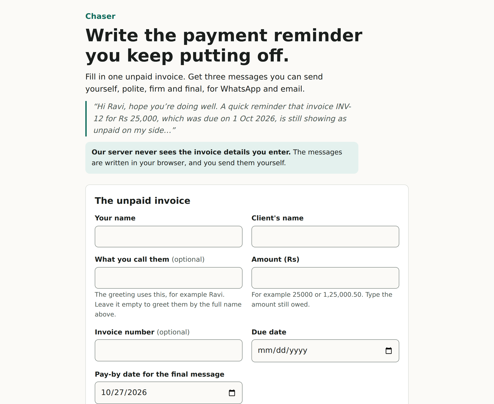
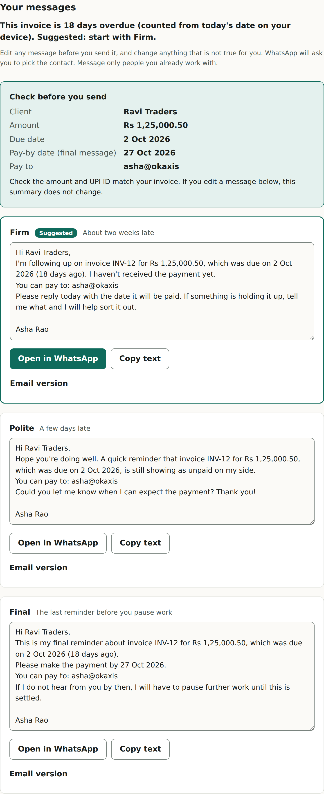

# Chaser

A free page that turns one unpaid invoice into three payment-reminder messages (polite, firm and final) for WhatsApp and email. No accounts, no tracking, nothing stored: the messages are written in your browser and you send them yourself.

| Form | Results |
|---|---|
|  |  |

It started as an experiment to test whether people would pay for this. The owner decided to keep it free, so the pricing button, the waitlist and the counters were removed (`docs/decisions/0007-free-tool-no-measuring-no-pricing.md`). The earlier research and design are kept in `docs/` as the record.

## Run
```
cd examples/chaser
npm start        # http://127.0.0.1:3000  (PORT and HOST change it)
npm test         # unit tests
npm run test:e2e # real-browser tests (needs a Chromium: CHROME_PATH=/path/to/chrome)
npm run mutation # breaks one promise at a time and checks a test notices
```

## What it promises, and how that is checked
- The server never receives what you type. After the page loads it makes no request at all, and the Content-Security-Policy has `connect-src 'none'`. A browser test fails on any request.
- Nothing is stored: no cookies, local storage or files.
- The generated text never contains threats or legal wording (a test checks every template against a forbidden-phrase list).
- Copy-and-send only: it never sends anything for you.
