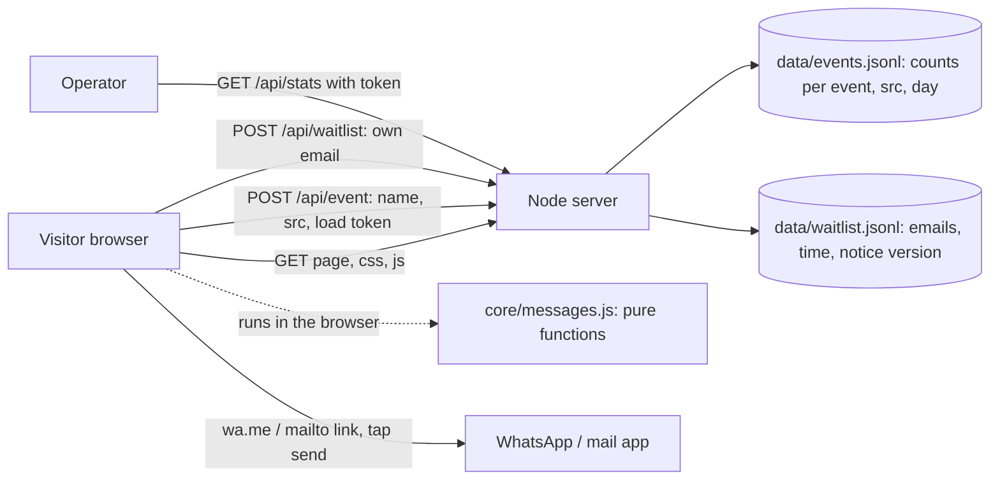

# Architecture: Chaser v1

Status: proposal for the owner to explain back (gate item `architecture-explained`). Nothing here is built beyond a scaffold. Read `system-design.md` first.

## Shape in one paragraph
A static page does all the real work in the browser. A tiny Node server serves that page, counts anonymous events and keeps an optional email waitlist. The message-writing logic lives in one pure module with no browser or network code, so the same file is used by the page and by the tests. There is no database, no account system and no third-party service.

## Component diagram

The dotted line matters: **the form inputs never go to the server.** The only requests the page makes are for its own files and the two small POSTs above; the Content-Security-Policy (`connect-src 'self'`) enforces that in production.

## Stack, one choice per layer (owner to confirm; the owner must be able to debug it)
| Layer | Choice | Rejected alternative and why |
|---|---|---|
| Runtime | Node 22 LTS, built-in `http`, `node:test`, no npm dependencies | Express: not needed for four routes; every dependency is a supply-chain and audit cost for a throwaway test |
| Front end | Plain HTML, one CSS file, one ES module (`public/`) | A framework: the page is one form and one result list; a build step would cost more than it saves |
| Message logic | `src/core/messages.js`, pure functions, shared by page and tests | Logic inside the page script: untestable and invites copy-paste drift between email and WhatsApp text |
| Storage | Append-only JSON Lines files on local disk | SQLite or Postgres: two small tables do not justify a database |
| Auth | Operator token (env var, compared in constant time) on `/api/stats` only; the same secret enables `?op=` to suppress counting; no user auth | Accounts: out of scope by design |
| Hosting | **Deferred** to the ship phase; needs a host with a persistent disk, or the storage module swapped for the host's key-value store | Serverless with ephemeral disk: counters would vanish between invocations |
| Third parties | None | Analytics, fonts, tag managers: break the privacy promise |

## Folder structure
```
chaser/
  src/
    server.js            # http server and routing only
    config.js            # env parsing and validation
    http/                # request handling: routes.js, static.js, limits.js
    core/                # messages.js (the product), format.js (rupees, dates); no I/O
    store/               # events.js, waitlist.js: the only code that touches the disk
  public/                # index.html, styles.css, app.js (imports ../src/core via /core/*)
  tests/                 # node:test: core, http, privacy (no network on generate)
  docs/                  # research, design, architecture, decisions
  .env.example
```
Rule: `core/` imports nothing from `http/`, `store/` or the DOM; routes call `core` and `store`, never the reverse.

## Background work
None. Counter writes are one buffered append per flush interval; there are no emails sent, no jobs, no schedulers.

## Third-party services and cost
None, so no recurring cost beyond hosting (undecided; a free tier may suffice at this volume, which has not been priced here).

## The three riskiest decisions
1. **Counting without cookies or accounts.** Unique visitors cannot be known, so every metric is an event count and page loads are the accepted proxy (`system-design.md` section 8). The server accepts an event only if it carries a per-load token issued by a prior `page_ready`, ignores bot-like user agents, drops events from the operator switch, and rate-limits per hashed IP held in memory. Bots and the owner's own traffic are the real threat to the result; the `src` tag lets the owner exclude them. (Found by the independent review, `design-review.md` H2.)
2. **"Nothing leaves your browser" as a hard promise.** One careless `fetch` or error-reporting call would break it. Mitigation: a test that fails if the generate flow issues any network request, and a Content-Security-Policy with `connect-src 'self'` and no third-party origins.
3. **The waitlist email.** The only personal data the server stores (plus IPs in memory, hashed, for rate limiting). Mitigation: separate file, honeypot and per-IP limit, timestamp and notice version stored, deletion on request, notice naming the operator next to the field, and a hard end date. The operator name and contact are still an owner blocker. A lawyer should review before anything beyond this.

## What is not decided
Hosting provider and domain (needs a persistent disk, or the `store/` module swapped for a managed counter), where traffic comes from, the interview plan, the operator name for the notice, and the template wording (the wording is the product and needs review by real freelancers). The review also noted that a static host plus one managed counter would be simpler than this server; the Node server is kept because it has no dependencies and the `store/` boundary makes the swap easy.
