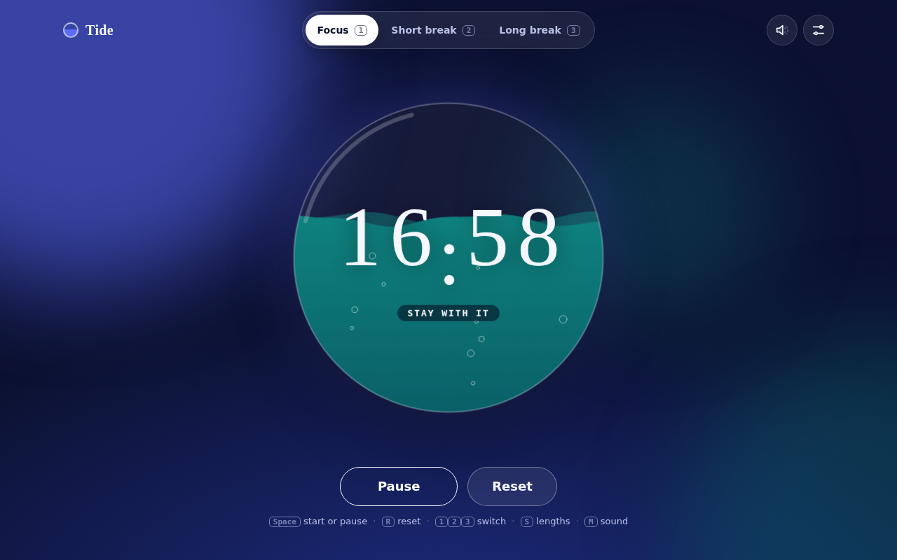
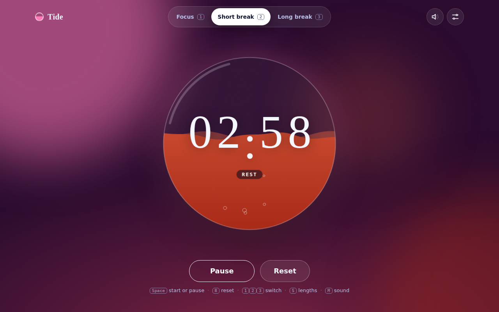
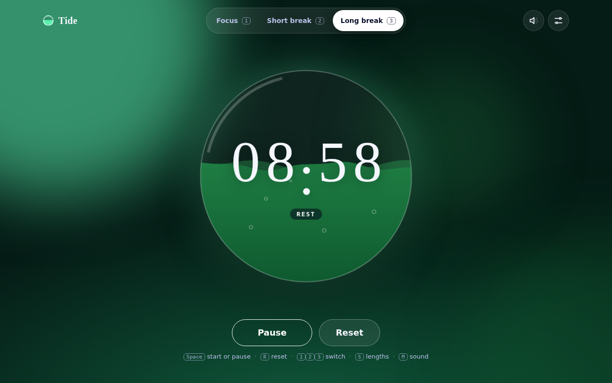
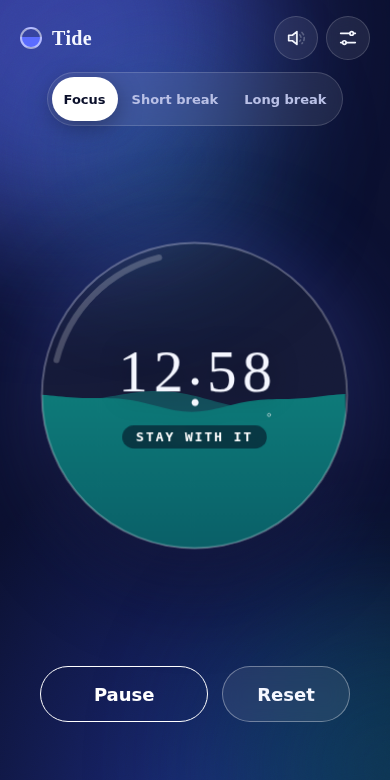

# Tide

A focus timer shaped like a glass of water. The liquid drains as time passes; the digits roll like an odometer; each mode is its own colour world.

| Focus | Short break | Long break | Phone |
|---|---|---|---|
|  |  |  |  |

Built as a test of HyperSkill's "make something with crazy UI and test it" flow. Static page, no runtime dependencies, no build step.

## Run it
```
npm start        # http://127.0.0.1:3000/
```

## Use it
`Space` start or pause, `R` reset, `1` `2` `3` switch mode, `S` lengths, `M` sound (off by default). Touch the glass to stir it. Lengths and sound are saved in your browser if it allows storage; without storage it still works.

## How it works
- `timer.js`: pure state machine. It stores a deadline timestamp, not a counter, so a sleeping tab never loses time. The clock is injected, so it is unit tested without waiting.
- `liquid.js`: canvas 2D renderer (waves, bubbles, ripples, splash). With reduced motion it draws still frames and never starts an animation loop.
- `styles.css`: colours are registered `@property` values, so a mode change cross-fades the whole page. Contrast is checked by a test.

## Tests
```
npm test         # 15 unit tests (timer, palette contrast)
npm run test:e2e # 23 real-browser tests (Playwright + axe-core)
```
The browser tests drive a fake clock, so a 25-minute session runs in seconds. They cover: timing, sleeping tabs, keyboard use, settings and validation, blocked storage, odometer digits, liquid animation, touch, reduced motion and accessibility in every mode. They need a Chromium (`CHROME_PATH=/path/to/chrome`).

Measured in headless software rendering: about 14 frames per second. A real GPU is faster.
