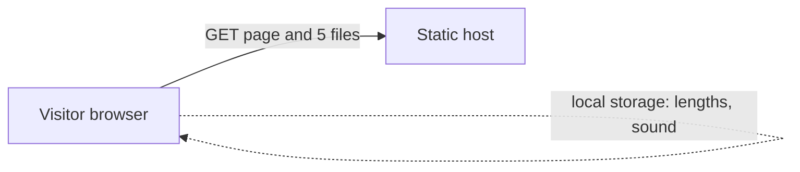

# System design: Tide

Written after the build; it describes what exists. Basis: `research.md`.

## 1. Purpose
A free focus timer that runs entirely in the browser. It is not a business and collects nothing.

## 2. Roles and tenancy
- One kind of visitor, anonymous. No accounts, no roles.
- **Tenancy: none.** Nothing belongs to a user on any server, because there is no server-side data. The only stored values are the visitor's own timer lengths and sound setting in their browser's local storage.

## 3. Core workflow
Pick a mode (focus, short break, long break), press start, watch the glass drain and the digits roll, hear or see the end, optionally continue into the suggested next mode. Pause, resume, reset. Lengths and sound are set in a dialog. Keyboard: Space, R, 1 2 3, S, M.

## 4. Requirements
- The remaining time comes from a stored deadline timestamp, so it stays right when a tab sleeps or is throttled.
- Keyboard operable; no serious axe finding in any colour world or with the dialog open; white text on the liquid keeps at least 3:1 contrast in all three worlds (computed from the palette, not measured on rendered pixels). Screen-reader behaviour has had automated checks only, no manual test with a real screen reader.
- With reduced motion requested, no animation loop and no rolling digits; the timer still works.
- Works when local storage is blocked.
- The page makes no network request after it loads. No cookies, no third-party files, no analytics.

## 5. Architecture
Static files: `index.html`, `styles.css`, `app.js` (wiring), `timer.js` (logic layer, pure, clock injected), `liquid.js` (canvas drawing). `scripts/serve.js` is a small local server with a file allow-list and `/api/health`, used for development and tests. The deployed copy is plain static files on the host, with no server code.

## 6. Dependencies, each with a reason
- `playwright-core` (dev only): drives a real browser for the end-to-end tests.
- `axe-core` (dev only): automated accessibility checks.
- Nothing at runtime: the shipped page has no dependencies.

## 7. Data
| Data | Where | Personal? | Retained |
|---|---|---|---|
| Timer lengths, sound on/off | The visitor's browser local storage | No | Until the visitor clears it |
| Host access logs (IP, URL) | Kept by the host, outside this app | Yes | Per the host's policy |

## 8. Out of scope
Accounts, syncing between devices, task lists, statistics or history, notifications when the tab is closed, a native app, any server-side data, analytics, advertising.

## 9. Known limits
- A running session is lost if the page is reloaded or closed; only the lengths, the sound setting and today's finished-session count are saved.
- Time uses the computer's wall clock on purpose, so sleep is handled. A clock set back cannot extend a session beyond its full length; a clock set forward ends it early.
- The "reduced motion" setting is read once when the page loads.
- The chime needs the sound setting on and a start click in the same page visit; browsers may still keep audio silent in a background tab.
A browser may slow timers in a background tab; Tide recalculates from the deadline on the next tick, so the display catches up but no sound plays while the tab is frozen. Animation speed on real phones is untested.
